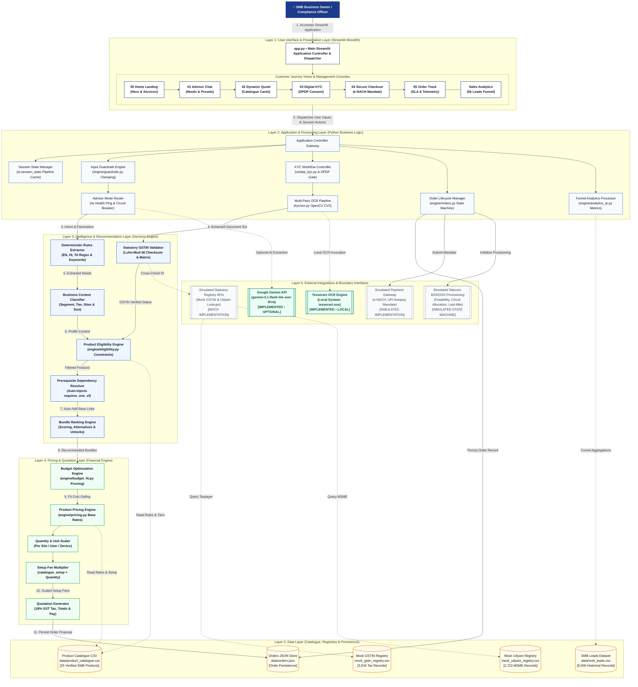
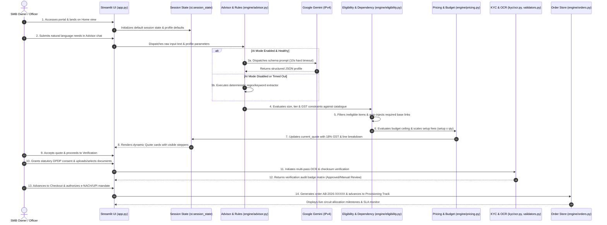

# Accel Business — Solution Architecture Specification
**Enterprise Track A: Autonomous SMB Digital Onboarding**  
**Document Version:** 1.0.0 • **Statutory Reference Date:** 2026-07-15  
**Architectural Baseline:** Modular Monolith with Hybrid AI & Deterministic Rules Engine

---

## 1. Executive Summary & Architectural Mission

The **Accel Business – Udyam Digital** platform is an enterprise-grade autonomous onboarding engine designed to solve India's small and medium business (SMB) digital adoption bottleneck. Historically, acquiring telecom, cloud, and digital security solutions for SMBs required an average of **17.6 days**, involving field sales agent visits, manual document handoffs, error-prone KYC checks, and frequent drop-offs (**32% drop-off at needs assessment, 56% drop-off at quote acceptance**).

Accel Business replaces this fragmented legacy sales cycle with a **zero-salesperson, single-sitting digital onboarding experience**. The architecture combines:
1. **Multilingual Conversational Discovery** (English, Hindi, Tamil) with optional Google Gemini LLM extraction and instant deterministic rules fallback.
2. **100% Deterministic Catalogue Validation** adhering strictly to telecom regulatory eligibility, prerequisite dependencies, and scaled pricing.
3. **Smart KYC Verification** compliant with the **Digital Personal Data Protection (DPDP) Act 2023**, incorporating multi-pass computer vision OCR, Luhn-mod-36 GSTIN checksum validation, and mock registry cross-checks.
4. **Transparent Quotation & Provisioning Tracking** generating statutory GST-compliant proposals and real-time telecom circuit provisioning telemetry.

```
+-------------------------------------------------------------------------------------------------------+
|                                    ACCEL BUSINESS HIGH-LEVEL TOPOLOGY                                 |
+-------------------------------------------------------------------------------------------------------+
|  [ User Interface: Streamlit 1.35+ ] <---> [ Application State Manager: st.session_state ]            |
|                                                     |                                                 |
|                 +-----------------------------------+-----------------------------------+             |
|                 |                                   |                                   |             |
|                 v                                   v                                   v             |
|   [ Intelligence Layer ]                 [ Smart KYC Pipeline ]               [ Financial Engine ]    |
|   • Regex/Rules Extractor                • OpenCV Preprocessing               • Pricing Scaler        |
|   • Gemini AI (Optional IPv4)            • Tesseract OCR Engine               • Setup Fee Multiplier  |
|   • Eligibility Matrix                   • Luhn-mod-36 Checksum               • Budget Optimizer      |
|   • Dependency Resolver                  • Mock Registry Lookups              • Statutory 18% GST     |
|                 |                                   |                                   |             |
|                 +-----------------------------------+-----------------------------------+             |
|                                                     |                                                 |
|               [ Data & Storage: Product Catalogue CSV • Local JSON Orders • Mock Registries ]          |
+-------------------------------------------------------------------------------------------------------+
```

---

## 2. 6-Layer Architecture Breakdown

The solution is designed as a **modular monolith** in Python, prioritizing execution speed, zero network flakiness, strict data privacy, and deterministic reliability.

```
docs/solution_architecture.png
```
*(Rendered high-resolution architecture diagram available in `docs/solution_architecture.png` and editable Mermaid source in `docs/solution_architecture.mmd`)*



---

### Layer 1 – User Interface & Presentation Layer
Implemented in `app.py` and `ui/*.py`, this layer renders the responsive web application:
- **Application Controller (`app.py`)**: Handles top-level page configuration (`st.set_page_config`), session state initialization, and high-level routing across 4 main views (`Home`, `Customer Journey`, `KYC Verification Desk`, `Sales Analytics`).
- **Sidebar & Navigation (`ui/styles.py`, `app.py`)**: Renders journey stage steppers, persistent cart order summary (Monthly subtotal, One-time setup, First month payable), and system health monitors (Tesseract OCR status, LLM Engine status, and the **AI mode (Gemini)** toggle).
- **Presentation Views**:
  - `ui/step_advisor.py` (**01 Advisor**): Multilingual natural language chat interface, sample persona quick-load buttons (Dental Clinic, Kirana Store, 3-Site Restaurant, Manufacturing Plant), requirement badges, and recommended bundle presentations.
  - `ui/step_quote.py` (**02 Quote Review**): Live quote cards displaying strictly catalogue data (Product Name, ID, Category, Unit, Unit Price, Line Monthly, Setup Total, Contract Months, Install Days), inline quantity steppers, item removal buttons, and statutory 18% GST calculation.
  - `ui/step_kyc.py` (**03 Digital KYC**): Statutory DPDP Act 2023 consent modal, specimen applicant picker (K01–K12), live file uploaders for Business Registration, Udyam, Signatory ID, and Address Proof, accompanied by live OCR verification badges.
  - `ui/step_checkout.py` (**04 Secure Checkout**): Payment mandate setup (e-NACH, UPI Autopay, Corporate Net Banking), billing address capture, and one-click order authorization.
  - `ui/step_track.py` (**05 Activation Track**): Real-time provisioning timeline (Order Confirmed $\rightarrow$ Feasibility Verified $\rightarrow$ Circuit Allocated $\rightarrow$ Last-Mile Fiber Laid $\rightarrow$ CPE Delivered & Activated) and live SLA uptime monitors.
  - `ui/page_analytics.py` (**Sales Analytics**): Executive BI dashboard analyzing 5,000 historical SMB leads, conversion funnel stages, drop-off root causes, and segment-specific Customer Acquisition Cost (CAC).
- **Editorial Design System (`ui/styles.py`)**:
  - Color Tokens: Primary Navy (`#1E3A8A`), Ink text (`#111827`), Muted body (`#616B7A`), Sand panel (`#E8DFCB`), Sky panel (`#93C5FD`), Background (`#F4F5F7`), Card (`#FFFFFF`), Hairline (`#D9DCE1`).
  - Strict WCAG AAA/AA Contrast: All text on white/page is $\ge 4.5:1$ (Ink on white is $16.15:1$; Navy on white is $10.3:1$). Muted text is strictly forbidden on Sand or Sky panels.
  - Responsive Typography Clamps: Hero headline `clamp(40px, 5.2vw, 70px)` with `hyphens: none`, section headings `clamp(28px, 3.4vw, 44px)`, card titles `20px / 1.25`.

---

### Layer 2 – Application & Processing Layer
Coordinates business logic, state lifecycle, and input protection:
- **Session State Manager (`st.session_state`)**: Guarantees pipeline continuity across page reloads and step navigation. Persists `business_profile`, `selected_items`, `current_quote`, `kyc_result`, and `dpdp_consent_granted`.
- **Input Guardrails & Boundaries (`engine/guardrails.py`)**: Protects the application against boundary violations and extreme values before widgets are initialized. Clamps employee counts to $[1, 10000]$, sites to $[1, 500]$, and monthly budget to $[0, 1000000]$.
- **Advisor Mode Router & Circuit Breaker (`engine/advisor.py`)**:
  - Implements a cached 4-second health check ping when AI mode is enabled.
  - Enforces a strict 10-second hard timeout on Gemini API invocations with **zero retries** to guarantee total user wait time never exceeds 10 seconds.
  - If Gemini is slow or unavailable, automatically disengages the toggle and falls back seamlessly to offline deterministic rules.
- **KYC Workflow Controller (`ui/step_kyc.py`)**: Enforces DPDP consent as a mandatory precondition before any file parsing or OCR execution occurs.
- **Multi-Pass OCR Pipeline (`kyc/ocr.py`)**: Uses OpenCV (`cv2`) image processing (grayscale, contrast normalization, morphological ROI cropping, thresholding) to prepare documents for character recognition.
- **Order Lifecycle Manager (`engine/orders.py`)**: Handles order serialization, unique order ID generation (`AB-2026-XXXXX`), and state transitions.

---

### Layer 3 – Intelligence & Recommendation Layer
Responsible for transforming unstructured inputs into compliant telecom product bundles:
- **Deterministic Multilingual Extractor (`engine/advisor.py`)**:
  - Robust regex and keyword dictionaries covering English, Hindi, and Tamil phrases.
  - Extracts business intent, locations, employee counts, site counts, GST status, and specific digital needs (e.g. mapping "failover", "prevent downtime", "backup connectivity" to P09 Backup 4G/5G Failover).
- **Business Context Classifier**: Determines the business operational profile and maps it to target customer segments (`micro`, `prof`, `multi`, `mfg`).
- **Product Eligibility Engine (`engine/eligibility.py`)**:
  - Validates candidates against rules in `product_catalogue.csv`.
  - Enforces minimum employee thresholds (`min_employees`), minimum site thresholds (`min_sites`), and city tier availability (`available_city_tiers`).
  - Unlisted cities default to Tier 2 with an explicit advisory notification.
- **Statutory GSTIN Validator (`kyc/validators.py`)**:
  - Validates 15-character GSTIN format (`^[0-9]{2}[A-Z]{3}X[A-Z][0-9]{4}[A-Z][1-9A-Z]Z[0-9A-Z]$`).
  - Computes Luhn-mod-36 checksum verification.
  - Strictly enforces GSTIN requirements for mandatory products: **P03, P05, P06, P10, P12, P13, P14, P15, P21, P24**. (P19 and P20 do not require GSTIN).
- **Prerequisite Dependency Resolver (`engine/eligibility.py`)**:
  - Evaluates `requires_one_of` expressions in the catalogue.
  - Automatically injects required base connectivity products (e.g., adding P02 Biz Fibre 300 when P11 Static IP or P12 Cloud Telephony is requested alone).
  - Strictly adheres to catalogue definitions: never pairs P11 Static IP with leased lines (P05/P06), as P11 explicitly requires P01, P02, or P03.
- **Bundle Ranking & Alternative Engine (`engine/advisor.py`)**: Compiles primary recommended bundles, provides modular alternative selections, and highlights actionable unlock tips (e.g. indicating how many additional staff are needed to unlock leased lines).

---

### Layer 4 – Pricing & Quotation Layer
Calculates transparent and mathematically verified commercial proposals:
- **Product Pricing Engine (`engine/pricing.py`)**: Reads verified baseline rates (`price_min_inr_per_month`, `one_time_setup_inr`) from the catalogue.
- **Unit & Volume Scaling**: Scales units dynamically based on business size (per-site broadband, per-line postpaid, per-user cloud productivity, per-device endpoint security, per-camera CCTV).
- **Setup Fee Multiplier**:
  $$\text{Line Setup INR} = \text{catalogue\_one\_time\_setup\_inr} \times \text{quantity}$$
  Applied consistently across all products P01–P25 (verified against 100% of the 248 leads in `smb_leads.csv`).
- **Budget Optimization Engine (`engine/budget_fit.py`)**:
  - Validates total bundle price against the customer's budget ceiling.
  - If budget is exceeded, iteratively removes lowest-priority optional items while strictly safeguarding base connectivity and prerequisite dependencies.
  - Returns clear explanation of pruned items and resulting monthly savings.
- **Quotation Generator (`engine/pricing.py`)**:
  - Calculates subtotal recurring monthly fees.
  - Calculates subtotal one-time setup charges.
  - Calculates statutory **18% GST**:
    $$\text{Statutory Tax} = (\text{Monthly Subtotal} + \text{One-Time Setup}) \times 0.18$$
  - Computes First Month Payable total, contract duration, and estimated installation lead times.

---

### Layer 5 – Data Layer
Local repositories providing ground truth and persistence:
- **Product Catalogue (`data/product_catalogue.csv`)**: 25 verified SMB products defining categories, unit descriptions, price boundaries, setup fees, contract terms, city tiers, employee thresholds, site minimums, GSTIN requirements, and dependency expressions.
- **Mock GSTIN Registry (`data/mock_gstin_registry.csv`)**: 3,534 synthetic tax records containing legal names, trade names, registration dates, taxpayer status, and addresses.
- **Mock Udyam Registry (`data/mock_udyam_registry.csv`)**: 2,723 synthetic MSME registration records containing enterprise classifications, unit names, and PIN codes.
- **Historical Leads Dataset (`data/smb_leads.csv`)**: 5,000 synthetic leads from Q1 2026 powering sales analytics, funnel leakage diagnostics, and conversion benchmarks.
- **Orders JSON Store (`data/orders.json`)**: Persistent local JSON datastore managed via `engine/orders.py` storing placed orders, customer details, and tracking statuses.
- **Specimen KYC Store (`kyc_documents/`)**: 47 specimen document images across 12 test applicants (K01–K12) used for deterministic compliance audits.
- **Configuration & Secrets (`.env`, `.streamlit/config.toml`)**: Runtime configuration specifying model names, timeouts, and disabling browser telemetry (`gatherUsageStats = false`).

---

### Layer 6 – External Integrations & System Boundaries
Explicitly distinguishes implemented external systems from simulated boundaries:

| Integration / Service | Category | Implementation Type | Technical Mechanism |
| :--- | :--- | :--- | :--- |
| **Google Gemini API** | AI / LLM | **Implemented (Optional)** | `google-genai` SDK using `gemini-3.1-flash-lite`. Network transport forced to IPv4 (`local_address="0.0.0.0"`) to prevent IPv6 PMTU black-holing. 10s timeout, zero retries. |
| **Tesseract OCR** | Computer Vision | **Implemented (Local System)** | Local binary (`tesseract.exe`) invoked via `pytesseract` wrapper with OpenCV preprocessing. |
| **Statutory Registries** | Government KYC | **Mock Service** | Fast in-memory lookup against `mock_gstin_registry.csv` and `mock_udyam_registry.csv` combined with algorithmic checksum validation. |
| **Banking Payment Gateway** | Financial / Mandate | **Simulated Service** | UI-driven mandate authorization simulating e-NACH, UPI Autopay, and Net Banking mandate creation. |
| **Telecom BSS/OSS** | Provisioning Telemetry | **Simulated State Machine** | Local state machine simulating circuit provisioning across 5 chronological stages with SLA tracking. |

---

## 3. End-to-End Data Flow (14-Stage Execution Pipeline)

The complete end-to-end lifecycle spans 14 clearly defined operational stages:



### Detailed Stage Walkthrough

1. **Application Access**: The user lands on the Home view. `app.py` triggers `init_session()` to instantiate default state structures in `st.session_state`.
2. **Profile & Requirements Input**: The user inputs business parameters (employees, sites, location, GSTIN) and natural language requirements in English, Hindi, or Tamil.
3. **Input Guardrail Clamping**: `engine/guardrails.py` clamps numeric inputs within safe operational limits ($[1, 10000]$ employees, $[1, 500]$ sites, $[0, ₹10,00,000]$ budget) to protect downstream components.
4. **Hybrid Extraction Routing**:
   - If **AI mode (Gemini)** is toggled ON, a cached 4-second health check ensures endpoint availability. The query is routed to `gemini-3.1-flash-lite` over IPv4 with a 10s strict timeout.
   - If AI mode is OFF or times out, the deterministic rules engine extracts slot parameters instantly without network latency.
5. **Context & Segment Classification**: Extracted parameters are evaluated to determine the business operational category (`micro`, `prof`, `multi`, `mfg`).
6. **Product Eligibility Filtering**: `engine/eligibility.py` validates catalogue rules against profile attributes. Unlisted cities default to Tier 2 with an advisory badge.
7. **Prerequisite Dependency Injection**: The dependency engine evaluates `requires_one_of` expressions. If a standalone dependent product (e.g. P11 Static IP) is selected, its prerequisite base link (P01/P02/P03) is automatically added to the bundle.
8. **Bundle Ranking & Alternative Synthesis**: The recommendation engine ranks bundles by relevance score, provides alternative product options, and compiles actionable upgrade tips.
9. **Budget Ceiling Optimization**: `engine/budget_fit.py` validates the monthly bundle against the customer's budget limit, pruning optional non-essential items while safeguarding base connectivity.
10. **Pricing Calculation & Setup Scaling**: `engine/pricing.py` calculates recurring line items and strictly scales setup charges as $\text{catalogue\_setup} \times \text{quantity}$.
11. **Quotation Generation & Review**: `QuoteResult` is constructed, calculating 18% statutory GST, contract commitments, and installation lead times. The user inspects the proposal in `ui/step_quote.py`.
12. **DPDP Statutory Consent Gate**: Before document submission, the user must explicitly grant consent under the Digital Personal Data Protection Act 2023.
13. **Multi-Pass OCR & Compliance Validation**: Specimen documents (K01–K12) or user uploads are preprocessed via OpenCV and parsed via Tesseract OCR. Extracted GSTINs and Udyam numbers are checksum-validated and cross-referenced with local mock registries.
14. **Checkout Mandate & Circuit Provisioning**: The user selects an e-NACH/UPI mandate option. An immutable order record (`AB-2026-XXXXX`) is written to `data/orders.json`, and the tracker view initializes the 5-stage provisioning timeline.

---

## 4. Security, Privacy & DPDP Compliance Architecture

The application is architected from the ground up to respect statutory privacy frameworks:
1. **Digital Personal Data Protection (DPDP) Act 2023 Compliance**:
   - Mandatory explicit consent modal prior to document ingestion.
   - All OCR processing runs locally in-memory; documents are never transmitted to third-party cloud OCR services.
   - PII masking: Aadhaar numbers are masked to display only the last 4 digits (`XXXX-XXXX-1234`), and PAN numbers are redacted in UI logs.
2. **Telemetry Isolation**:
   - Browser usage telemetry is explicitly disabled in `.streamlit/config.toml` (`gatherUsageStats = false`).
3. **Repository Secret Hygiene**:
   - `.env` and private keys are strictly quarantined by `.gitignore`. Only `.env.example` is committed.
   - Specimen KYC document images, customer order stores (`orders.json`), and private mock datasets are excluded from public source control.
4. **Resilient Network Architecture**:
   - Google Gemini HTTP transport is explicitly forced to IPv4 (`local_address="0.0.0.0"` via `httpx` custom transport). This eliminates IPv6 PMTU connection stalls and timeout loops to `generativelanguage.googleapis.com`.

---

## 5. Technical Stack & Runtime Dependencies

| Tier / Component | Technology | Version | Purpose in Solution |
| :--- | :--- | :--- | :--- |
| **Language Runtime** | Python | `3.15.0+` | Core execution environment |
| **Presentation Framework** | Streamlit | `1.35.0+` | Modular monolith web UI, state management & reactive stepper |
| **Data Processing** | Pandas | `2.2.0+` | High-speed catalogue parsing, registry indexing & funnel analytics |
| **Generative AI** | Google GenAI SDK | `0.1.1+` | Multilingual conversational extraction (`gemini-3.1-flash-lite`) |
| **Computer Vision** | OpenCV Headless | `4.9.0+` | Grayscale conversion, adaptive thresholding & ROI cropping |
| **Optical Character Recognition** | Pytesseract / Tesseract | `0.3.10+ / 5.x` | Local binary OCR engine for KYC documents |
| **Data Visualization** | Plotly | `5.20.0+` | Interactive conversion funnels and leakage drop-off visualizations |
| **Testing & Quality Assurance** | Pytest | `8.0.0+` | 89-test verification suite covering rules, pricing, and fuzzing |
| **Layout & Visual Verification** | Playwright | `1.40.0+` | Headless Chromium browser automation for UI & diagram rendering |
| **Diagramming Standard** | Mermaid.js | `10.x` | Architecture diagramming syntax and visual topology generation |

---

## 6. Verification & Quality Assurance Alignment

The architecture has been verified against the project's comprehensive automated testing suite:
- **Pytest Test Suite (`pytest -v`)**: **89/89 tests passing (100%)** covering multilingual intent extraction, boundary fuzzing ($10,000$ employees, $500$ sites), catalogue dependency validation, setup fee scaling across 248 leads, and WCAG AAA/AA visual contrast ratios ($\ge 4.5:1$).
- **Playwright Layout & Overlap Suite (`scripts/verify_layout_overlap.py`)**: Clean exit code 0 across Desktop (1440px), Landscape Tablet (1024px), Portrait Tablet (768px), and Mobile (390px) viewports with **zero bounding box overlaps, zero clipped text, and zero horizontal page overflow**.

##7. Screenshots


